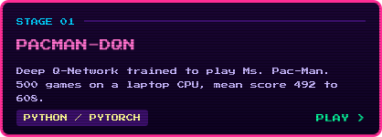
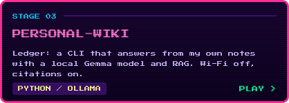
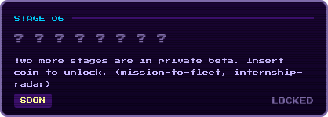
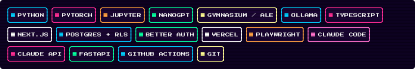

<!--
  BuildingBrian profile README — 90s arcade / vaporwave edition.
  Every SVG in assets/ is generated by tools/build_assets.py (pixel text is
  rendered to paths, animations are SMIL). Edit the script, not the SVGs.
-->

  

  

**Brian Arevalo Ramos** — MBA candidate at UC Berkeley Haas, building agentic AI projects in the open.

- 🕹️ **Current quest:** MBA 290T *Fundamentals of Agentic AI* — training agents, tiny LLMs, local RAG, and shipping the evidence with every repo
- 🧾 **Play style:** reproducible over flashy. Every README links to the file that proves the number.
- 💻 **Rig:** Intel MacBook Pro, CPU only. No GPU, no excuses.
- 🎧 **Soundtrack:** FrankJavCee, vaportrap, SimpsonWave at 2 AM

  

  

  
  
  
  
  
  

  

  
  

  

  

  

  

  
  
  

  

