<!--
  BuildingBrian profile README: 90s arcade / vaporwave edition.
  Every SVG in assets/ is generated by tools/build_assets.py (pixel text is rendered to paths,
  animations are SMIL). Edit the script, not the SVGs. The game behind PRESS START lives in docs/
  and is served by GitHub Pages; its source is in game-src/.
-->

  

  

  <a href="https://www.linkedin.com/in/brianarevalo">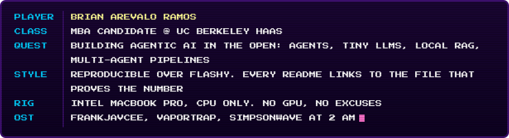</a>

  

  

  
  <a href="https://github.com/BuildingBrian/custom-llm">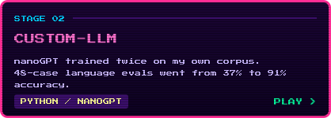</a>
  
  <a href="https://github.com/BuildingBrian/networking-tracker">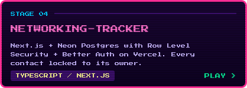</a>
  <a href="https://github.com/BuildingBrian/blue-cohort-daily">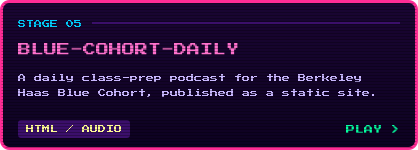</a>
  <a href="https://github.com/BuildingBrian/spotify-review-pipeline">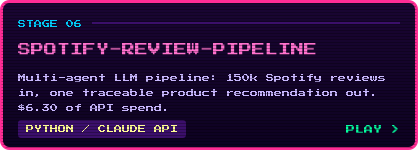</a>
  <a href="https://github.com/BuildingBrian/mba-internship-radar">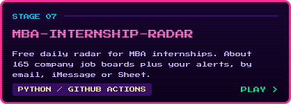</a>
  

  

  <a href="https://buildingbrian.github.io/BuildingBrian/">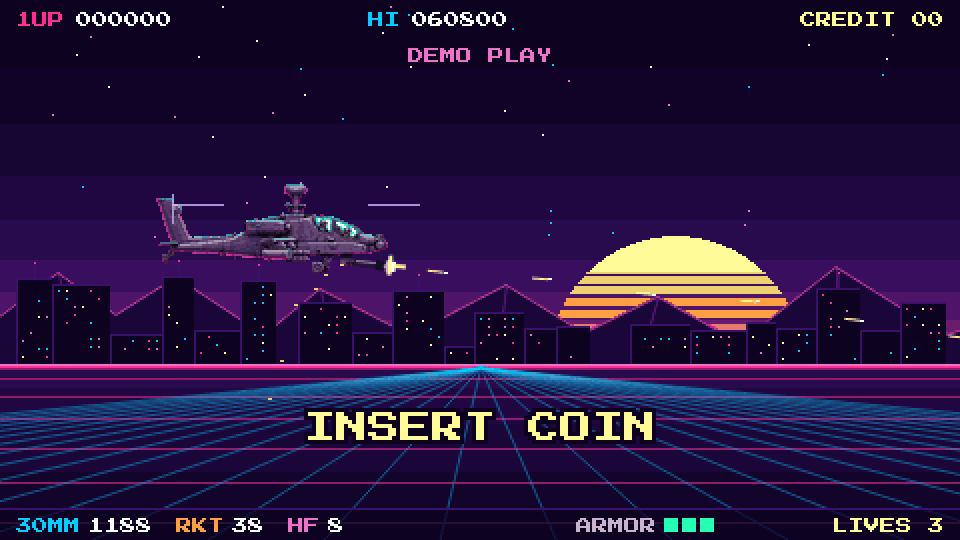</a>

  

  

  <a href="https://buildingbrian.github.io/BuildingBrian/">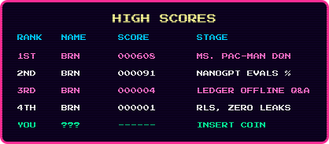</a>
  <a href="https://github.com/BuildingBrian?tab=repositories">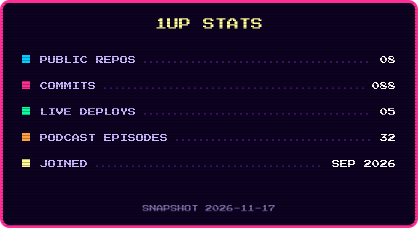</a>

  

  

  <a href="https://github.com/BuildingBrian?tab=repositories">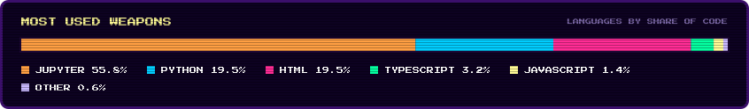</a>

  

  
  
  
  

  <a href="https://buildingbrian.github.io/BuildingBrian/"></a>

